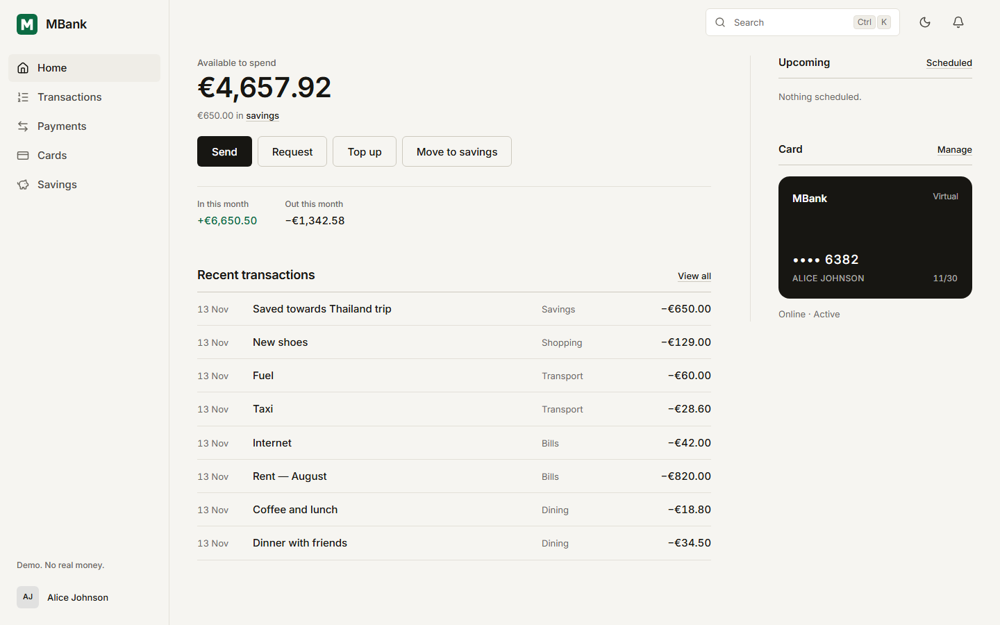
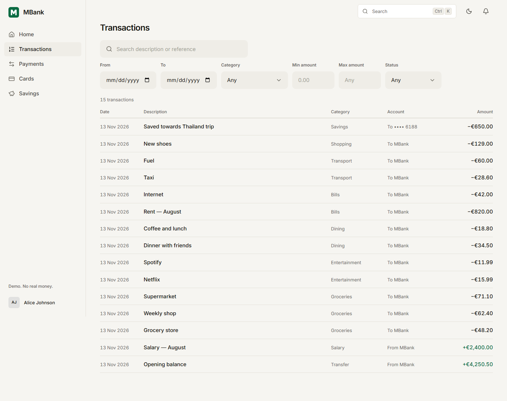
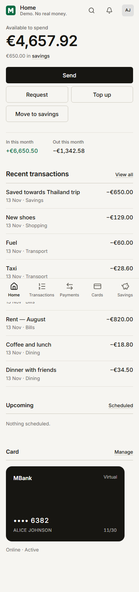

# MBank

A banking simulation built as a portfolio project: accounts, cards, payments, savings and an
administration console on top of a double-entry ledger.

> **It is a simulation.** No real money, card or bank is involved. Balances are demo data, card
> numbers are generated, and "Top up" adds play money from the bank's own ledger account.

| Home | Transactions | Phone |
|---|---|---|
|  |  |  |

More screens, at 375 and 1440px, are in [docs/screenshots/after](docs/screenshots/after). The same
screens before the redesign are in [docs/screenshots/before](docs/screenshots/before).

## What you can do

- **Customers:** see balances; send money in four steps (recipient, amount, review, receipt) with
  the payee's name confirmed before paying; make a simulated top-up; search and filter
  transactions; manage payees, standing orders and payment requests; issue virtual and plastic
  cards, freeze them and set limits and controls; save towards goals; download monthly statements
  as CSV; see signed-in devices and sign them out.
- **Administrators:** review payments held by the risk rules and approve or reject them; reverse a
  settled payment; freeze, unfreeze and fund accounts; suspend users; read the audit trail.

## How it works

| Part | Technology |
|---|---|
| Backend | Java 21, Spring Boot 3.5, Spring Security with JWT, Flyway |
| Database | PostgreSQL 16 |
| Frontend | React 19, TypeScript (strict), Vite, React Router, hand-written CSS |
| Tests | JUnit 5 and Testcontainers; Vitest; Playwright |

The parts that matter for money:

- Amounts are `BigDecimal` in Java and `NUMERIC(19,4)` in the database. The browser never adds
  money as floating-point numbers: it converts to whole cents first (`frontend/src/utils/money.ts`).
- Every payment writes two ledger entries that sum to zero. An account's balance is a cached total
  of its ledger entries.
- Settling a payment locks both accounts in a fixed order, so two payments cannot spend the same
  balance at once.
- Every payment and top-up needs an `Idempotency-Key`. Sending the same request again returns the
  first result instead of paying twice. The web app keeps the key when the network fails, so a
  retry is safe.

More detail: [architecture](docs/architecture.md), [API](docs/api.md),
[database](docs/database.md), [security](docs/security.md), [design system](docs/design-system.md).

## Run it

You need Docker with Compose v2.

```bash
cp .env.example .env
```

Edit `.env`: set `DB_PASSWORD` to any value and `JWT_SECRET` to the output of
`openssl rand -base64 48`. Then:

```bash
docker compose up --build
```

| What | Where |
|---|---|
| Web app | <http://localhost:3000> |
| API | <http://localhost:8080> |
| API documentation (Swagger UI) | <http://localhost:8080/swagger-ui.html> |

The first start takes a minute or two while the images build. The database is seeded with demo
users when `SEED_DEMO_DATA=true` (the default in `.env.example`):

| Role | Username | Password |
|---|---|---|
| Customer | `customer.a` | `Customer#2026!A` |
| Customer | `customer.b` | `Customer#2026!B` |
| Administrator | `admin` | `Admin#2026!Demo` |

These exist only in the demo database. The sign-in page lists them in development, or in a build
made with `VITE_DEMO_MODE=true`.

### Without Docker

You need JDK 21, Node 20 or newer and a PostgreSQL 16 database named `minibank`.

```bash
cd backend
JWT_SECRET=$(openssl rand -base64 48) ./mvnw spring-boot:run -Dspring-boot.run.profiles=dev
```

```bash
cd frontend
npm install
npm run dev
```

The dev server runs on <http://localhost:5173> and forwards `/api` to `http://localhost:8080`.

## Tests

| Command | What it checks |
|---|---|
| `./mvnw verify` in `backend/` | Unit tests, integration tests against a real PostgreSQL in Docker, Checkstyle, SpotBugs and a coverage minimum |
| `npm run typecheck`, `npm run lint`, `npm test` in `frontend/` | TypeScript, ESLint, and Vitest unit tests |
| `npm run test:e2e` in `frontend/` | Playwright: sign in, top up, send money, find both in the history, at a desktop and a phone size. Needs the app running. |

Last full run, on 12–13 November 2026 on Windows 11 with Docker Desktop:

- Backend: 187 unit tests and 281 integration tests, no failures. Coverage from that run's JaCoCo
  report: 86.9% of instructions, 67.9% of branches.
- Frontend: 66 Vitest tests; ESLint and the TypeScript check clean.
- Playwright: the end-to-end test passed at both sizes against the Vite dev server and against the
  Docker build on port 3000.
- A screenshot script (`frontend/scripts/screenshots.mjs`) loaded every screen at 375 and 1440px and
  found no horizontal overflow.

GitHub Actions ([.github/workflows/ci.yml](.github/workflows/ci.yml)) runs all of this on every push
and pull request, then starts the Docker stack, runs a smoke test and the Playwright test against it.
That workflow has not yet run with the lint and Playwright steps added on this branch.

## Known limits

- **The deployed frontend has no backend.** <https://mini-bank-silk.vercel.app> serves the web app
  only, so signing in there fails. Run it locally to try it.
- Access and refresh tokens are kept in `localStorage`, not in httpOnly cookies.
- Rate limits are counted in memory, so they reset on restart and are per server instance.
- Two top-ups sent at the same moment are each checked against the daily cap before either one
  settles, so the cap can be exceeded by one request. The daily transfer limit has the same gap.
- There is no currency exchange: money moves only between accounts in the same currency.
- Statements export as CSV only, not PDF.
- The interface is in English only.
- A few older screens (Accounts, Analytics, Payees, Requests, Scheduled, Notifications, Support)
  still use the previous card-based layout. Login, Register, the card order dialog and the command
  palette are each still one file of 350 to 450 lines.
- Email and SMS are logged rather than sent in the Docker setup, and the one-time code is returned
  in the API response so phone sign-in can be tried without a phone. The `prod` profile refuses to
  start with that switched on.

## License

[MIT](LICENSE)
