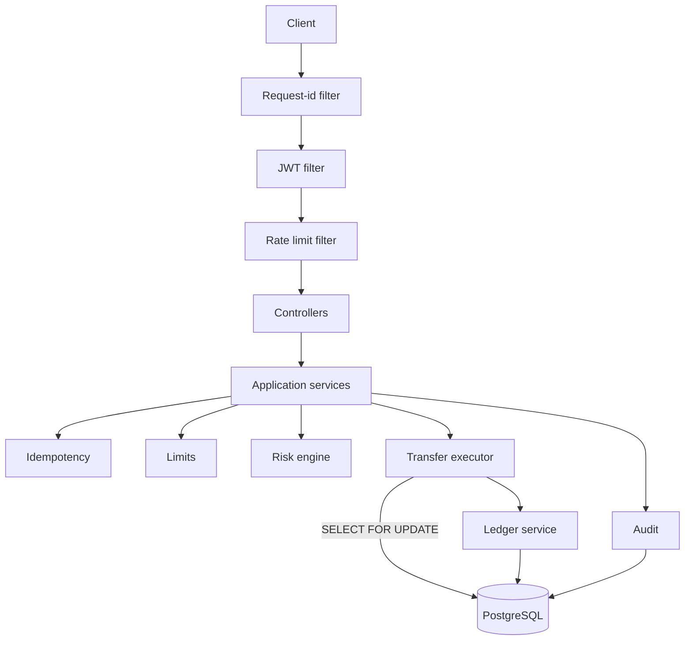

# MBank

A production-oriented modular banking platform demonstrating secure authentication, double-entry
ledger accounting, transactional money transfers, idempotent payment APIs, concurrency control,
risk scoring, audit logging and a full DevOps pipeline.

[](.github/workflows/ci.yml)
[](https://openjdk.org/projects/jdk/21/)
[](https://spring.io/projects/spring-boot)
[](https://www.postgresql.org/)
[](#testing)
[](#testing)
[](LICENSE)

---

## What this is

MBank is a small digital bank. Customers register, hold accounts in EUR, USD or GBP, carry cards,
send and request money, save towards goals, budget by category, schedule standing orders, read their
own analytics and manage their signed-in devices; administrators freeze accounts, review flagged
transfers, reverse mistakes and read the audit trail.

The interesting part is not the CRUD. It is what a system has to get right before it is allowed to
move money:

- **Money is never a `double`.** `BigDecimal` throughout, `NUMERIC(19,4)` in the database, and an
  amount that is too precise for its currency is rejected rather than silently rounded.
- **Every movement is double-entry.** Two ledger rows per transfer, always balanced. The account
  balance column is a cache of that ledger, and a test asserts the two never diverge.
- **Two concurrent transfers cannot spend the same balance.** Pessimistic row locking with a
  deterministic lock order, proven by tests that run real threads.
- **A retried payment is not a second payment.** Idempotency keys with request-hash verification.
- **A failed login still increments its counter.** Transaction boundaries chosen so security-relevant
  side effects survive the rollback that reports the failure.
- **Nothing on screen is invented.** Savings progress is an account balance, budget spend is a sum
  over real transactions, a statement's opening balance is derived from the ledger, and an insight
  is arithmetic the customer could check. Where the data cannot support a statement, none is made.

Design decisions — including the ones that were rejected, and why — are written up in
[docs/architecture.md](docs/architecture.md).

---

## Table of contents

- [Quick start](#quick-start) · [Demo walkthrough](#demo-walkthrough) · [Features](#features)
- [Architecture](#architecture) · [Tech stack](#tech-stack) · [Project structure](#project-structure)
- [Running locally](#running-locally-without-docker) · [Configuration](#configuration)
- [API](#api) · [Testing](#testing) · [CI/CD](#cicd) · [Observability](#observability)
- [Screenshots](#screenshots) · [Verification status](#verification-status)
- [Future work](#future-work) · [License](#license)

---

## Quick start

Requires Docker with Compose v2. Nothing else — no local Java, Node or PostgreSQL.

```bash
git clone <your-fork-url> mini-bank
cd mini-bank

cp .env.example .env
# Set a real JWT secret (the app refuses to start in prod with the published one):
#   openssl rand -base64 48

docker compose up --build
```

| Service | URL |
|---|---|
| Web app | <http://localhost:3000> |
| API | <http://localhost:8080> |
| Swagger UI | <http://localhost:8080/swagger-ui.html> |
| Health | <http://localhost:8080/actuator/health> |

### Demo credentials

Created automatically when `SEED_DEMO_DATA=true`. Obviously non-production, and printed at startup so
nobody mistakes them for real ones.

| Role | Username | Password | Opening balance |
|---|---|---|---|
| Customer | `customer.a` | `Customer#2026!A` | €4,250.50 |
| Customer | `customer.b` | `Customer#2026!B` | €800.00 |
| Admin | `admin` | `Admin#2026!Demo` | — |

---

## Demo walkthrough

A ten-minute tour that exercises everything worth showing. Account numbers are random per
installation — read them from the dashboard or the startup log.

**1. Send money.** Sign in as `customer.a`, open **Send money**, send €100 to `customer.b`'s account
number. The balance drops immediately and the transfer gets a reference like `TRX-2026-JND964HP`.

**2. See both sides.** Sign in as `customer.b` — the same transfer appears as an incoming credit.
One movement, two perspectives, one pair of ledger rows.

**3. Inspect the ledger.** As either party:

```bash
curl -s $API/transfers/{id}/ledger -H "Authorization: Bearer $TOKEN" | jq
```

Exactly two entries — one `DEBIT`, one `CREDIT`, equal amounts, each with the balance it left behind.

**4. Prove idempotency.** Send the same request twice with the same `Idempotency-Key`:

```bash
KEY=$(uuidgen)
BODY='{"fromAccountId":"'"$FROM"'","toAccountNumber":"'"$TO"'","amount":50.00,"currency":"EUR"}'

curl -si -X POST $API/transfers -H "Authorization: Bearer $TOKEN" \
  -H 'Content-Type: application/json' -H "Idempotency-Key: $KEY" -d "$BODY" | grep -E 'HTTP|reference'

curl -si -X POST $API/transfers -H "Authorization: Bearer $TOKEN" \
  -H 'Content-Type: application/json' -H "Idempotency-Key: $KEY" -d "$BODY" | grep -E 'HTTP|Idempotent-Replay|reference'
```

Same reference, `Idempotent-Replay: true`, and the balance moves **once**. Now change the amount and
reuse the key: `422 IDEMPOTENCY_KEY_CONFLICT`.

**5. Trip the risk engine.** Send €3,000 in one go. Large amount plus balance sweep pushes the score
past the review threshold, so the API answers `202 Accepted` with status `PENDING` — the transfer
exists but **no money has moved**.

**6. Approve it as an administrator.** Sign in as `admin`, then
`POST /api/v1/admin/transfers/{id}/approve`. Now the money moves. Reject instead and it becomes
`FAILED`, with the reason recorded.

**7. Freeze an account.** `PATCH /api/v1/admin/accounts/{id}/freeze`, then try to pay into it:
`409 ACCOUNT_FROZEN`. Unfreeze and it works again.

**8. Reverse a settled transfer.** `POST /api/v1/admin/transfers/{id}/reverse` with a reason. The
balances return to where they were, the original is marked `REVERSED` rather than deleted, and the
history shows **both** movements — which is how a real ledger records a correction.

**9. Read the audit trail.** `GET /api/v1/admin/audit-logs` shows the logins, the transfers, the
freeze and the reversal, each stamped with the correlation id of the request that caused it.

**10. Try to cheat.** As `customer.a`, request `customer.b`'s account: `404`, not `403` — confirming
the id exists would itself be a disclosure. Call any `/admin` endpoint: `403`. Post `"role":"ADMIN"`
in a profile update: `400`, because unknown properties are rejected outright.

---

## Features

### Banking
- Accounts in EUR, USD and GBP, with unguessable account numbers (`MB-` + 12 random digits)
- Transfers with full validation: ownership, status, currency, amount precision, sufficient funds
- **Double-entry ledger** — the authoritative record; balances are a maintained cache of it
- **System funding accounts** per currency, so deposits have a real counterparty and the ledger
  balances from the first row
- Administrative deposits, account freeze/unfreeze, and reversal by compensating entries
- Transaction history with database-side pagination, filtering and whitelisted sorting
- Saved payees with soft delete and favourites, so relationship history survives for risk scoring
- **Transaction categories** — thirteen buckets, derived from the payment description by a keyword
  heuristic that declines to guess rather than filing a payment wrongly; either party may correct one
- **Confirmation of payee** — typing an account number resolves the holder's first name and last
  initial before the transfer is reviewed, so a mistyped digit costs nothing

### Cards
- **A range of seven cards in three materials** — Standard, Ocean, Violet, Coral and Lime in matte
  plastic; Metal in brushed anodised graphite; and a two-tone Special Edition. Each is one flat
  colour plus a material layer, at true ID-1 proportions (85.60 x 53.98 mm, so
  `aspect-ratio: 1.586`)
- The material is **derived from the design rather than stored twice**: the server's `design` enum
  already encodes it one-to-one, and a second column would eventually disagree with the first. A
  virtual card reports no material at all, because it is a number rather than an object
- Physical and virtual cards, with a freeze/unfreeze that is reversible and a cancel that is not
- Per-card daily, monthly, ATM and online spending caps, reported against actual account outflow
- **Five usage controls per card** — online payments, contactless, cash withdrawals, international
  use and the magnetic stripe — each enforced server-side. The stripe defaults to off: it is the
  only channel with no cryptographic authentication
- Card numbers are generated locally with a scheme-appropriate prefix and a **valid Luhn check
  digit**, so they behave like card numbers everywhere a form checks one
- **The number is stored only as AES-256-GCM ciphertext**, with a keyed HMAC fingerprint for
  uniqueness; ordinary reads never decrypt anything
- **No verification value is stored, in any form.** The CVV is derived on demand from a server-side
  key — the same shape as an issuer deriving one from a card verification key — so there is no
  column to leak
- Revealing full details is a separate, rate-limited, individually audited `POST`
- Every card is marked *simulated* in the API contract and on screen: MBank is connected to no
  payment processor, and these credentials authorise nothing anywhere

### Authentication
- Three ways in: **phone + one-time code**, email + password, and username + password — the password
  field accepts any of username, email or verified phone, because people do not remember which they
  used
- SMS codes with a 5-minute life, 5 attempts, and a 60-second resend cooldown, all configurable
- **Codes are never stored.** Only a keyed HMAC is — a bare digest of six digits is a rainbow table
- Exactly one code is live per destination at a time, so resending replaces rather than accumulates
- A phone number is verified **before** the account exists, and the proof travels as a single-use
  ticket, so nobody can register against a number they do not control
- Email verification by expiring single-use link, with HTML and plain-text alternatives
- `SmsService` and `EmailService` abstractions with Twilio and SMTP implementations; the default
  development stubs log instead of sending, and **production refuses to start** while either is
  still a stub or while one-time codes are exposed in API responses

### Money management
- **Savings goals**, each backed by a real account MBank opens for it. Contributing is a settled
  internal transfer, so the money is traceable and can be withdrawn at any time. There is no stored
  progress figure — progress *is* the backing account's balance, so the screen cannot disagree with
  the ledger
- **Monthly budgets** per category, measured against real transactions at read time. A recategorised
  payment is reflected immediately, with no counter to rebuild
- **Standing orders** — scheduled and recurring payments that genuinely execute. A background runner
  puts each due order through the ordinary transfer path, so limits, the risk engine, idempotency
  and the ledger all apply. The idempotency key is derived from the order and its due date, so a
  restart cannot pay twice; a refusal is recorded, the customer is told, and the schedule advances
  rather than retrying into an empty account all day
- **Money requests** that move nothing by existing. Only the payer can settle one, and doing so
  creates an ordinary transfer from their own account under their own limits
- **Spending analytics** — income, spending, category breakdown and a daily series. Direction is
  decided by account ownership, not transfer type, so moving money into savings is counted as
  neither income nor spending
- **Insights** computed from the customer's own history, returned as figures rather than sentences
  so the wording is formatted in the reader's locale. An empty list when the data cannot support one
- **Statements** by calendar month, with CSV export. The opening balance is derived from the ledger,
  so `opening + in − out = closing` holds by construction
- **Notification centre** written inside the transaction that caused the event, so a notification
  cannot exist for a payment that rolled back
- **Support tickets** with a message thread, going to a human queue — nothing here generates a reply

### Correctness under load
- Pessimistic row locking (`SELECT … FOR UPDATE`) with **ascending account-id lock ordering** to
  make opposing transfers deadlock-free
- Optimistic `@Version` columns as a second line of defence
- Database `CHECK` constraints as the last: a customer balance can never go negative, even if the
  service layer had a bug
- Idempotent transfer creation with request-hash verification and stored-response replay
- An explicit transfer **state machine** that refuses illegal transitions

### Security
- JWT access tokens (15 min) plus rotating refresh tokens (7 days), stored only as SHA-256 hashes
- **Refresh token reuse detection** with family-wide revocation
- **A security centre** listing signed-in devices, one row per login rather than per token, each
  endable server-side; plus sign-in history read from the audit trail rather than a second store
- **Password recovery** in three steps, where the middle one exchanges the code for a short-lived
  single-use ticket — a code that stayed valid while somebody typed a new password would be a code
  that could be attacked across that window. Completing it revokes every session
- The reset endpoint **answers identically whether or not the number is registered**, because a
  reset form that confirms which numbers exist is a customer list an attacker can enumerate
- BCrypt at cost 12, a real password policy, and account lockout after repeated failures
- Timing-equalised login so the endpoint cannot be used to enumerate usernames
- Role-based authorization plus ownership checks in one enforcement point
- Per-endpoint rate limiting with continuous token-bucket refill
- Security headers, explicit CORS origins, mass-assignment rejection, no stack traces in responses
- Startup checks that refuse to run production with a repository-published secret, a simulated
  message provider, or one-time codes exposed in API responses
- Card numbers encrypted at rest under keys derived per purpose, and no CVV stored at all

### Interface
- A **token-driven design system**: opaque surfaces, hairline edges, and hierarchy carried by
  spacing and type rather than by blur and shadow. Translucency survives in exactly four places —
  the navigation, sheets, toasts and the command palette — all of which have content scrolling
  underneath them, so the blur is doing a job rather than a look
- **One accent per screen**, drawn from five: blue for movement, violet for cards, green for money
  arriving, yellow for savings, coral for attention. Using all of them at once is how a fintech
  product starts looking like a toy
- The balance is the only block on a page **filled with ink**, and it re-points the status colours
  at its own background — the light theme's green is unreadable on near-black, and the dark theme's
  is unreadable on the near-white block that replaces it
- **Light and dark themes** from a single token set, applied before first paint so there is no flash
  of the wrong one. An explicit choice is remembered; with none stored, the operating system decides
- One typeface, Inter, chosen for its **tabular numerals**, because this application is mostly
  columns of amounts. A display face would be the first thing to date the product
- Avatars coloured by a hash of the account number, so the same payee is the same colour on every
  screen and a list can be scanned before it is read
- Balance waveform derived from the customer's **real settled transactions**, not sample data
- Full keyboard support, a focus ring that changes colour per theme rather than being invisible in
  one of them, and `prefers-reduced-motion` handling that removes decorative motion rather than
  shortening it
- A connection banner that names the address that failed and the command that fixes it, then clears
  itself once the API answers
- A **card carousel built on native scroll-snap**, so momentum, rubber-banding and flick velocity
  are the platform's rather than a reimplementation of them
- A **home screen the customer arranges**: seven optional blocks that can be added, removed and
  reordered. The balance and the four quick actions are not among them, because a home screen that
  can be configured into not showing the balance is a home screen with a bug in it
- Every touch target is **at least 44px under `pointer: coarse`** — keyed on the finger rather than
  on viewport width, since a 1280px touchscreen needs large targets and a narrow browser window on a
  laptop does not. Where an element is deliberately smaller, the hit area grows around it
- A **six-digit code field that is one input**, not six: the platform sees a single
  `autocomplete="one-time-code"` field, so SMS autofill, paste and backspace all simply work

### Operations
- Append-only audit trail with correlation ids on every record
- Business metrics: transfers by status and currency, value settled, risk decisions, idempotent
  replays, login failures
- Structured JSON logging in containers; `X-Request-Id` accepted, validated, and echoed back
- Health probes wired into the container healthcheck, so Compose waits for readiness rather than a timer

---

## Architecture

A **modular monolith**. A transfer must move money out of one account and into another atomically;
in one database that is one transaction, and splitting it across services would replace a solved
problem with a distributed one. Module boundaries are real, so a genuine need to extract one later
has a seam to cut along.

```
controller  →  application service  →  domain  →  repository  →  PostgreSQL
```



The full reasoning, including the transfer sequence diagram, the concurrency proof and the
deliberate limitations, is in **[docs/architecture.md](docs/architecture.md)**.

| Document | Contents |
|---|---|
| [architecture.md](docs/architecture.md) | Modules, transfer flow, concurrency, idempotency, ledger, testing strategy, limitations |
| [database.md](docs/database.md) | ER diagram, migrations, constraints, indexes and why each exists |
| [security.md](docs/security.md) | Threat-by-threat: authentication, authorization, input handling, secrets, rate limiting |
| [api.md](docs/api.md) | Every endpoint, the error-code catalogue, pagination, worked examples |
| [design-system.md](docs/design-system.md) | The design system: palette, type, surface levels, theming, motion, performance, accessibility |

---

## Tech stack

| Area | Choice | Why |
|---|---|---|
| Language | Java 21 | Records, pattern matching, sealed interfaces |
| Framework | Spring Boot 3.5.16 | Mature transaction management and security |
| Database | PostgreSQL 16 | ACID, row locking, check constraints, partial indexes, JSONB |
| Migrations | Flyway | Versioned schema; Hibernate runs `validate`, never `create` |
| Persistence | Spring Data JPA / Hibernate 6 | Specifications for dynamic queries, `@EntityGraph` against N+1 |
| Security | Spring Security + JJWT | Filter chain, method security, JWT signing |
| Docs | springdoc-openapi | OpenAPI 3 generated from the code |
| Metrics | Micrometer + Prometheus | Business metrics, not just JVM ones |
| Logging | Logback + logstash encoder | JSON in containers, MDC correlation |
| Testing | JUnit 5, Mockito, AssertJ, Testcontainers | Real PostgreSQL in integration tests |
| Quality | Checkstyle, SpotBugs, JaCoCo | All wired into `mvn verify` |
| Frontend | React 19, TypeScript, Vite | Strict mode, no `any` |
| UI | Hand-written design system, Lucide icons | Tokens for both themes, ~9KB of gzipped CSS; no UI framework, no template |
| Containers | Docker multi-stage, nginx | Non-root, JRE-only runtime, layered jar caching |
| CI/CD | GitHub Actions | Build, test, scan, image build, live stack smoke test |

**Redis is deliberately absent.** The only candidate use is distributed rate limiting, and this
stack is single-node. Adding it for the keyword would be dishonest engineering; the limitation is
documented instead.

---

## Project structure

```
mini-bank/
├── backend/
│   ├── src/main/java/com/minibank/
│   │   ├── account/          # accounts, balances, ownership
│   │   ├── admin/            # back-office endpoints
│   │   ├── audit/            # append-only audit trail
│   │   ├── auth/             # registration, login, tokens
│   │   ├── beneficiary/      # saved payees
│   │   ├── card/             # issuing, freezing, limits, card-number encryption
│   │   ├── common/           # errors, money, security, persistence, rate limiting
│   │   ├── idempotency/      # reservations and replay
│   │   ├── infrastructure/   # metrics, seeding, startup checks
│   │   ├── ledger/           # double-entry postings
│   │   ├── limit/            # transfer limits
│   │   ├── notification/     # SmsService and EmailService, real and development
│   │   ├── risk/             # rules-based scoring
│   │   ├── transfer/         # the core: validation, settlement, queries
│   │   ├── user/             # profiles
│   │   └── verification/     # one-time codes and email tokens
│   ├── src/main/resources/db/migration/   # V1–V13
│   ├── src/test/java/com/minibank/        # 158 unit + 187 integration tests
│   ├── config/               # Checkstyle and SpotBugs configuration
│   └── Dockerfile
├── frontend/
│   ├── src/
│   │   ├── api/              # transport + one module per resource
│   │   ├── auth/             # session context and route guards
│   │   ├── components/
│   │   │   ├── auth/         # OtpInput, PhoneField, VerificationPanel
│   │   │   ├── card/         # BankCard, carousel, stack, chip and marks, modals
│   │   │   └── ui/           # Surface, Button, Sheet, Tabs, Badge, …
│   │   ├── hooks/            # useAsync, useReducedMotion
│   │   ├── layouts/          # app shell and auth shell
│   │   ├── pages/            # one file per screen, admin/ nested
│   │   ├── styles/           # tokens → base → surfaces → components → cards → layout → pages → screens
│   │   └── utils/            # money formatting, error translation
│   ├── nginx.conf            # SPA routing, caching, security headers
│   └── Dockerfile
├── docs/                     # architecture, database, security, api
├── .github/workflows/        # ci.yml, security.yml
├── docker-compose.yml
└── .env.example
```

About 11,700 lines of production Java across 174 files, 5,500 lines of tests across 40 files, and
8,600 lines of TypeScript with 3,900 lines of CSS.

---

## Running locally without Docker

Requires JDK 21, Node 20+, and a PostgreSQL 16 instance.

```bash
# 1. Database
docker run -d --name minibank-pg -p 5432:5432 \
  -e POSTGRES_DB=minibank -e POSTGRES_USER=minibank -e POSTGRES_PASSWORD=minibank \
  postgres:16-alpine

# 2. Backend — Flyway migrates and the demo data is seeded on first start
cd backend
JWT_SECRET=$(openssl rand -base64 48) ./mvnw spring-boot:run -Dspring-boot.run.profiles=dev

# 3. Frontend
cd frontend
npm install
npm run dev        # http://localhost:5173
```

The dev server proxies `/api` and `/actuator` to `http://localhost:8080`, so the browser only ever
talks to one origin and CORS cannot be the reason a request fails locally. Point it somewhere else
with `VITE_DEV_API_TARGET`. A production bundle has no server in front of it, so it calls the origin
baked in at build time from `VITE_API_BASE_URL`.

### "The API is not responding"

The web app says this when nothing answers at the API address — nearly always because the backend is
not running yet, or is still starting. It names the address it tried, retries on a backoff, and
clears itself the moment the API answers; there is nothing to reload.

```bash
docker compose ps                                  # is the API up and healthy?
curl -fsS http://localhost:8080/actuator/health     # does it answer directly?
docker compose logs -f backend                      # if it is up but unhealthy
```

The backend waits on the database's own health check before starting, so a slow first boot of
PostgreSQL shows up as roughly 30–45 seconds of that banner and then nothing.

---

## Configuration

Every setting is environment-driven; nothing sensitive is compiled in. See
[`.env.example`](.env.example).

| Variable | Purpose | Default |
|---|---|---|
| `DB_URL`, `DB_USERNAME`, `DB_PASSWORD` | Database connection | local dev values |
| `JWT_SECRET` | Signing secret, **min 32 chars** | none — startup fails without it |
| `CORS_ALLOWED_ORIGINS` | Exact origins; no wildcard | `http://localhost:5173` |
| `SEED_DEMO_DATA` | Create the demo users | `true` in dev/docker, forced off in prod |
| `CARD_ENCRYPTION_KEY` | Base64, 32+ bytes, protecting stored card numbers | empty — keys derived from `JWT_SECRET` |
| `APP_BASE_URL` | Where an email verification link points | `http://localhost:5173` |
| `SMS_PROVIDER` | `dev` logs, `twilio` sends | `dev` — **prod refuses to start on `dev`** |
| `EMAIL_PROVIDER` | `dev` logs, `smtp` sends via `spring.mail.*` | `dev` — **prod refuses to start on `dev`** |
| `TWILIO_ACCOUNT_SID`, `TWILIO_AUTH_TOKEN` | Twilio credentials | empty |
| `SMS_SENDER`, `EMAIL_SENDER` | What the recipient sees as the sender | `MBank`, `MBank <no-reply@mbank.local>` |
| `EXPOSE_VERIFICATION_CODES` | **Development only.** Returns the OTP in the API response | `false` — **prod refuses to start on `true`** |
| `SERVER_PORT`, `DB_POOL_SIZE` | Tuning | `8080`, `10` |

**Profiles:** `dev` (verbose logging, seeding), `docker` (env-driven, JSON logs), `prod` (no
defaults, Swagger disabled, seeding off, secret checks enforced), `test` (Testcontainers).

---

## API

Interactive documentation at **<http://localhost:8080/swagger-ui.html>**, the raw document at
`/v3/api-docs`, both disabled under `prod`. Full reference including the error-code catalogue:
**[docs/api.md](docs/api.md)**.

```bash
API=http://localhost:8080/api/v1

TOKEN=$(curl -s -X POST $API/auth/login -H 'Content-Type: application/json' \
  -d '{"username":"customer.a","password":"Customer#2026!A"}' | jq -r .accessToken)

curl -s $API/accounts -H "Authorization: Bearer $TOKEN" | jq

# Issue a card, then reveal its details. The reveal is a POST, not a GET: the response
# carries a card number, and a GET would be cacheable, linkable and replayable from history.
CARD=$(curl -s -X POST $API/cards -H "Authorization: Bearer $TOKEN" \
  -H 'Content-Type: application/json' \
  -d '{"type":"VIRTUAL","design":"HOLOGRAPHIC","label":"Online"}' | jq -r .id)

curl -s -X POST $API/cards/$CARD/details -H "Authorization: Bearer $TOKEN" | jq
```

Signing in with a phone number, end to end. With `EXPOSE_VERIFICATION_CODES=true` the code comes
back in the response, so no handset is needed locally; everywhere else it arrives by SMS and the
field is simply absent.

```bash
CODE=$(curl -s -X POST $API/auth/phone/code -H 'Content-Type: application/json' \
  -d '{"phoneNumber":"+998901234567","purpose":"LOGIN"}' | jq -r .developmentCode)

curl -s -X POST $API/auth/phone/login -H 'Content-Type: application/json' \
  -d "{\"phoneNumber\":\"+998901234567\",\"code\":\"$CODE\"}" | jq .user
```

Every error shares one shape, with a stable machine-readable `code` and the correlation id of the
request:

```json
{
  "timestamp": "2026-08-20T18:00:00Z",
  "status": 422,
  "code": "INSUFFICIENT_FUNDS",
  "message": "Account MB-713410971350 does not have sufficient funds for this transfer",
  "path": "/api/v1/transfers",
  "requestId": "6856015a-3271-409c-bce5-ad74341bec56"
}
```

---

## Testing

```bash
cd backend
./mvnw test      # 128 unit tests
./mvnw verify    # everything: Checkstyle, unit, integration, SpotBugs, JaCoCo
```

`verify` needs a running Docker daemon — the integration tests start real PostgreSQL through
Testcontainers.

| Suite | Count | Scope |
|---|---:|---|
| Unit | 128 | Money arithmetic, password policy, rate limiter, state machine, JWT, risk rules, limits, idempotency orchestration, account/reference generation |
| Integration | 141 | Real PostgreSQL: authentication, accounts, transfers, idempotency, concurrency, risk review, beneficiaries, administration, security, rate limiting |
| **Total** | **269** | 89.6% instruction coverage, 71.6% branch coverage (merged) |

**PostgreSQL, not H2.** What is under test *is* PostgreSQL behaviour: `SELECT … FOR UPDATE`,
`NUMERIC(19,4)`, partial unique indexes, JSONB, check constraints. An in-memory substitute would
either not support these or emulate them differently, so a green suite would prove nothing.

Notable cases:

| Test | What it proves |
|---|---|
| `TransferConcurrencyIT` | 100 EUR with two concurrent transfers of 80 → exactly one settles. Twenty concurrent transfers of 10 → exactly ten. Opposing transfers do not deadlock. Ledger stays consistent under contention |
| `TransferIdempotencyIT` | Replay returns the original result and creates one transfer; a different body is refused; failures replay as the same failure; keys are scoped per user |
| `TransferIT` | Balances, ledger balancing, rollback leaving no partial state, frozen accounts, currency mismatch, over-precise amounts, cross-customer access |
| `RiskReviewIT` | REVIEW holds money in place; approval settles; approving twice cannot pay twice |
| `AuthenticationIT` | Lockout, rotation, reuse detection burning the family, password change revoking sessions |
| `SecurityIT` | Every private endpoint refuses anonymous callers; forged, expired and foreign tokens rejected; no hashes or stack traces in responses |
| `AdminIT` | RBAC, freeze, deposit funded from the system account, reversal preserving history |

Coverage is measured across **both** suites and merged; the build fails below 70% instruction and
60% branch coverage. The floor is a floor, not a target — chasing a high number across DTOs and
generated accessors would measure effort, not confidence.

---

## CI/CD

Two workflows in [`.github/workflows`](.github/workflows):

**`ci.yml`** — on every push and pull request:
1. **Backend**: `mvn verify` — Checkstyle, 128 unit tests, 141 Testcontainers integration tests,
   SpotBugs, JaCoCo floor. Test and coverage reports uploaded; coverage summarised in the run.
2. **Frontend**: `npm ci`, strict type check, production build.
3. **Docker**: builds both images with layer caching, then **starts the whole stack and smoke-tests
   it** — health, frontend, OpenAPI, a real login, a real transfer, and an idempotent replay that
   must return the same reference. Building an image only proves it compiles; this proves it runs.

**`security.yml`** — on push, pull request and weekly:
- Trivy filesystem scan (dependency CVEs, secrets, misconfiguration)
- Trivy image scan for both images (base image and OS packages)
- CodeQL with `security-extended` for Java and TypeScript
- Results uploaded as SARIF to code scanning

[`dependabot.yml`](.github/dependabot.yml) keeps Maven, npm, Actions and Docker dependencies current,
with related updates grouped — a stream of one-line bumps is noise teams learn to ignore, which is
how a genuinely important update gets missed.

---

## Observability

| Endpoint | Access | Purpose |
|---|---|---|
| `/actuator/health` | Public | Liveness and readiness; the container healthcheck uses readiness |
| `/actuator/metrics` | `ADMIN` | Micrometer metrics |
| `/actuator/prometheus` | `ADMIN` | Prometheus scrape endpoint |

Business metrics beyond the JVM defaults:

```
minibank.transfers{status, currency}      minibank.risk.decisions{decision}
minibank.transfers.amount{currency}       minibank.idempotency.replays
minibank.login.failures
```

Every request carries an `X-Request-Id` — accepted from the client when well-formed, generated
otherwise — placed in the logging MDC, returned in the response, and stored on every audit row. One
id a user quotes leads straight to the log lines and the audit trail.

---

## Screenshots

The dashboard, running against the containerised API:

```
┌──────────────┬──────────────────────────────────────────────────────────────┐
│              │                                  ⌕ Search…    ◐   ⌾   ⇥      │
│  M MBank     ├──────────────────────────────────────────────────────────────┤
│    Personal  │                                                              │
│              │  Good morning, Alice                                         │
│  ▓ Overview  │                                                              │
│    Accounts  │                                                              │
│    Cards     │  ╭════════════════════════════════╮ ╭──────────────────────╮ │
│    Transfer  │  ║ ▤ Total balance          ░░░░░ ║ │ Send again    Manage │ │
│    Transacti │  ║                                ║ │                      │ │
│    Beneficia │  ║ €4,219.25                      ║ │  (AC) Accountant   › │ │
│              │  ║                                ║ │  (LA) Landlord     › │ │
│  ACCOUNT     │  ║ 1 account · EUR                ║ │  (✓) Security      › │ │
│    Security  │  ║                                ║ │                      │ │
│    Profile   │  ║ (➤)  (▥)   (⚇)    (▤)          ║ │                      │ │
│              │  ║ Send Accts Payees Activity     ║ │                      │ │
│  BACK OFFICE │  ║ ──────╱‾‾‾‾‾‾‾‾‾‾‾‾‾‾‾‾‾‾‾‾‾‾‾ ║ │                      │ │
│    Administr │  ╰════════════════════════════════╯ ╰──────────────────────╯ │
│              │                                                              │
│              │  Your cards                                        Manage    │
│              │  ╭────────────────────────────╮                              │
│              │  │ MBank             VIRTUAL  │  ◄ the deck: the active card │
│              │  │ ▨ ))))                     │    in front, the rest just   │
│              │  │                            │    showing behind it         │
│              │  │ 4845 •••• •••• 3544        │                              │
│              │  │ ALICE JOHNSON  08/30  VISA │                              │
│              │  ╰────────────────────────────╯                              │
│              │                                                              │
│              │  ╭─────────────╮ ╭─────────────╮ ╭─────────────╮             │
│              │  │ ↙ Money in  │ │ ↗ Money out │ │ ▤ Settled   │             │
│              │  │ €4,351.00   │ │ €31.25      │ │ 3           │             │
│              │  ╰─────────────╯ ╰─────────────╯ ╰─────────────╯             │
│              │                                                              │
│              │  Recent activity                                    See all  │
│              │  ╭──────────────────────────────────────────────────────────╮│
│              │  │ (SM) Smoke            Today · •••• 5643        −€31.25   ││
│              │  │  ↺   Reversal of TRX… Friday · •••• 5643      +€100.50   ││
│              │  │  ↗   Money out        Friday · •••• 5643    −€4,000.00 ⊘ ││
│              │  │ (RE) Rent             Friday · •••• 5643     −€100.50 ↺  ││
│              │  │  🏦  Opening balance   Friday · MBank    +€4,250.50   │    │
│              │  ╰──────────────────────────────────────────────────────────╯│
│  ╭─────────╮ │                                                              │
│  │ AJ Alice│ │                                                              │
│  ╰─────────╯ │                                                              │
└──────────────┴──────────────────────────────────────────────────────────────┘

   ═══  the balance block: the one surface on the page filled with ink, and the
        only place the month's change is stated
   ▨    the EMV chip, drawn as eight contacts in etched gold — CSS and SVG, no bitmap
   ))))  the contactless mark: four arcs, in whichever ink the face defines
   (AC) an avatar coloured by a hash of the account number — same payee, same colour
   ◐    the theme toggle: the operating system decides until you choose
```

Every figure above is real: the waveform inside the balance card is reconstructed from the
customer's settled transactions, the reversal and the failed transfer are genuine records, and
`MBank` as a counterparty is the system funding account that makes the opening balance a real
double-entry movement.

On a phone the same screen reorders itself so the wallet sits directly under the balance, and the
cards become a swipeable carousel:

```
   ┌─────────────────────────────┐
   │ M MBank              ◐  ⇥   │
   │                             │
   │ Good morning, Alice         │
   │                             │
   │ ╔═════════════════════════╗ │
   │ ║ ▤ TOTAL BALANCE         ║ │
   │ ║                         ║ │
   │ ║ €4,119.25   ↗ +2.4%     ║ │
   │ ║ 1 account · EUR         ║ │
   │ ║                         ║ │
   │ ╚═════════════════════════╝ │
   │                             │
   │ ╭───────────╮ ╭───────────╮ │
   │ │    (➤)    │ │    (⚇)    │ │  ◄ four quick actions, two by two on a
   │ │   Send    │ │  Request  │ │    phone: the largest targets on the
   │ ╰───────────╯ ╰───────────╯ │    screen, and none of them truncated
   │ ╭───────────╮ ╭───────────╮ │
   │ │    (⑂)    │ │    (▤)    │ │
   │ │Split a bill│ │   Save   │ │
   │ ╰───────────╯ ╰───────────╯ │
   │                             │
   │ Your cards         Manage   │
   │ ╭───────────────────────╮╭─ │
   │ │ MBank        VIRTUAL  ││ M│  ◄ the next card peeks: it says
   │ │ ▨ ))))                ││  │    "there is more" without an arrow
   │ │ 4845 •••• •••• 3544   ││ 4│
   │ │ ALICE JOHNSON   VISA  ││ A│
   │ ╰───────────────────────╯╰─ │
   │           ▬  ○              │  ◄ the active dot stretches to a capsule,
   │                             │    so it reads without relying on colour
   │ Recent                      │
   │ Salary             +€2,400  │
   │ Grocery               −€48  │
   │ ╭─────────────────────────╮ │
   │ ⌂     ▤     ⇄     ◔     ⚇   │  ◄ docked to the edge and safe-area aware:
   │Home  Cards  Send Insights Me│    a bar that meets the bezel is larger to
   │                             │    hit than one inset with rounded corners
   └─────────────────────────────┘
```

The card details screen, behind an explicit reveal:

```
        ╭────────────────────────────────────────────────╮
        │  Card details                               ✕  │
        │  Online                                        │
        │  ────────────────────────────────────────────  │
        │   Cardholder            ALICE JOHNSON          │
        │   Card number     4845 6434 4490 3544          │
        │   Expires                        08/30         │
        │   Security code                    773         │
        │                                                │
        │   ⚠ Simulated details. MBank has no payment    │
        │     processor. This number authorises nothing  │
        │     and will not work anywhere.                │
        │                                                │
        │   ╭──────────────────────────────────────────╮ │
        │   │              Hide details                │ │
        │   ╰──────────────────────────────────────────╯ │
        │   Hidden automatically after a minute.         │
        ╰────────────────────────────────────────────────╯
```

The number is decrypted for this response and nowhere else; the security code is derived from a
server-side key and is not stored in any column. Every reveal is written to the audit trail.

The risk review panel, opened from a held transfer in the back office:

```
        ╭────────────────────────────────────────────────╮
        │  Risk review                                ✕  │
        │  TRX-2026-JS3UBZV9                             │
        │                                                │
        │                  €700.00                       │
        │        MB-183768933569 → MB-286328163633       │
        │  ────────────────────────────────────────────  │
        │      ╭───╮      DECISION: REVIEW               │
        │     ╱  55 ╲     ⚠ 7 transfers started in the   │
        │    │ of 100│       last 5 minutes              │
        │     ╲     ╱     ⚠ Amount is more than 5x this  │
        │      ╰───╯         customer's recent average   │
        │                                                │
        │   ╭─────────────╮      ╭──────────────────╮    │
        │   │   Reject    │      │     Approve      │    │
        │   ╰─────────────╯      ╰──────────────────╯    │
        ╰────────────────────────────────────────────────╯
```

> Image captures can be dropped into `docs/screenshots/` and linked here. None are committed, so
> nothing in this README refers to a file that does not exist.

## Verification status

Stated explicitly, because "it should work" and "I ran it" are different claims. Every row below was
executed against the state of the repository as it stands.

| Check | Command | Status |
|---|---|---|
| Backend unit tests | `./mvnw test` | ✅ **187 passing**, 0 failures, 0 errors |
| Frontend build | `npm run build` | ✅ Clean, TypeScript strict, 85KB CSS / 503KB JS (15KB / 144KB gzipped) |
| Horizontal overflow | 20 routes × 10 viewports (320, 375, 390, 412, 480, 768, 1024, 1280, 1440, 1920) | ✅ **0 overflowing** — found and fixed three: a carousel that reserved width for an invisible copy of its own arrows, two page-header buttons that could not wrap, and a payee card whose min-content width escaped its grid track |
| Touch targets | 16 routes measured under emulated `pointer: coarse` | ✅ **0 under 44px** — two were raised (a 42px chip, a 40px icon button) and one text link had its hit area grown |
| Contrast | Every visible text node on 18 routes, in both themes, composited against its real painted background | ✅ **0 below the AA threshold.** Six token values were darkened and the card micro-labels removed to get there — see below |
| Card faces | Each of the seven measured analytically against every stop of its own gradient | ✅ All ≥ 4.5:1 for their ink. Coral and Special Edition were too light and were darkened |
| **Integration tests** | `./mvnw verify` | ⚠️ **Not executed here.** All 257 error with `Could not find a valid Docker environment`: they are Testcontainers-backed and this machine has no Docker daemon. Nothing in the failure output is a code failure |
| **Full stack** | `docker compose up --build` | ⚠️ **Not executed here**, same reason |
| **GitHub Actions runs** | — | ⚠️ **Not executed.** No remote repository exists yet, so the workflows have never run. The commands they invoke are the same ones verified locally |

The rows above were executed against the repository as it stands. The
functional rows in earlier revisions of this table — card controls persisting
server-side, categorisation, notification fan-out, statement arithmetic — were
verified against a running backend and are unchanged by the redesign, which
touched presentation only; they are not re-asserted here because this pass had
no database to run them against.

### What the contrast pass changed

Measured, not eyeballed. Every text node on every screen was composited against
the background actually painted behind it, in both themes:

- `--ink-3` held 4.68:1 on a white card but **4.18:1 inside a well**, which is
  where most of the labels using it actually sit. The token is now measured
  against the sunken surface, not the card.
- `--green`, `--yellow`, `--coral` and `--lime` were each a few percent short of
  4.5:1 on the sunken surface and were darkened.
- The **category avatars** drew their glyph in a chart colour on a 14% tint of
  itself: amber measured 2.4:1 and green 2.8:1. The glyph is now darkened at the
  point of use, so the chart palette keeps its vividness and every category
  clears 4.8:1.
- `--ink-4` is a placeholder token at 2.6:1. It was carrying real text in six
  places — sidebar section headings, the ⌘K key caps, chart axis labels, palette
  metadata — all of which now use `--ink-3`.
- The unread-count chip was white on `--coral-fill` at 10px: **3.6:1**. Count
  chips now use a darker ground.
- The **"CARDHOLDER" and "EXPIRES" captions on the card face were deleted.** At
  0.66em in 58% white they measured between 2.0:1 and 3.5:1 and were the least
  legible text in the product. They also carried no information — no issuer
  prints those words either.

## Future work

Clearly labelled as **not implemented**:

- Distributed rate limiting backed by Redis, replacing the in-process buckets
- Refresh tokens in httpOnly cookies with CSRF protection, replacing `localStorage`
- Domain events with an outbox table, if asynchronous consumers are ever added
- **Two-factor authentication.** The phone channel, the code lifecycle and the ticket exchange all
  exist and are used for sign-in and password recovery, but TOTP enrolment and backup codes are not
  built — so 2FA is not claimed
- **Real FX.** Accounts are held per currency and MBank refuses to convert between them. Faking a
  rate would misrepresent balances, so there is no exchange feature rather than a fictional one
- **PDF statements.** CSV export is implemented; PDF would need a rendering dependency and is not
  worth claiming until it exists
- **QR payments.** Not built. A QR code that only encodes an account number is a barcode, not a
  payment method, and presenting it as one would overstate what MBank does
- **International transfers.** Not built, and deliberately not simulated — the domestic path is real
  and an "international" one that behaved identically would be a lie about what happened
- KYC onboarding and sanctions screening
- Distributed tracing (OpenTelemetry) and a Grafana dashboard
- Read replicas for reporting
- **Localisation.** The interface is structured for it — user-facing copy is in components and one
  insights module rather than scattered through the server — but only English exists. The language
  picker lists the others as unavailable rather than offering them and ignoring the choice
- A scheduled job to expire stale money requests. Expiry is currently derived from the clock on
  read, which is correct but means an expired request keeps its row until somebody looks at it

---

## License

[MIT](LICENSE).
