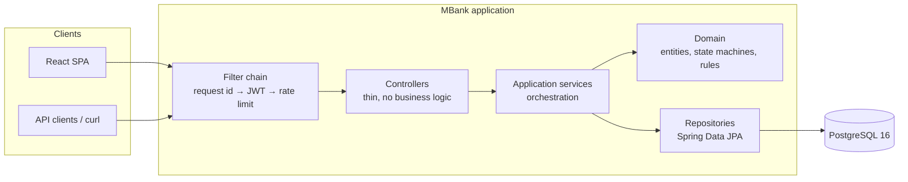
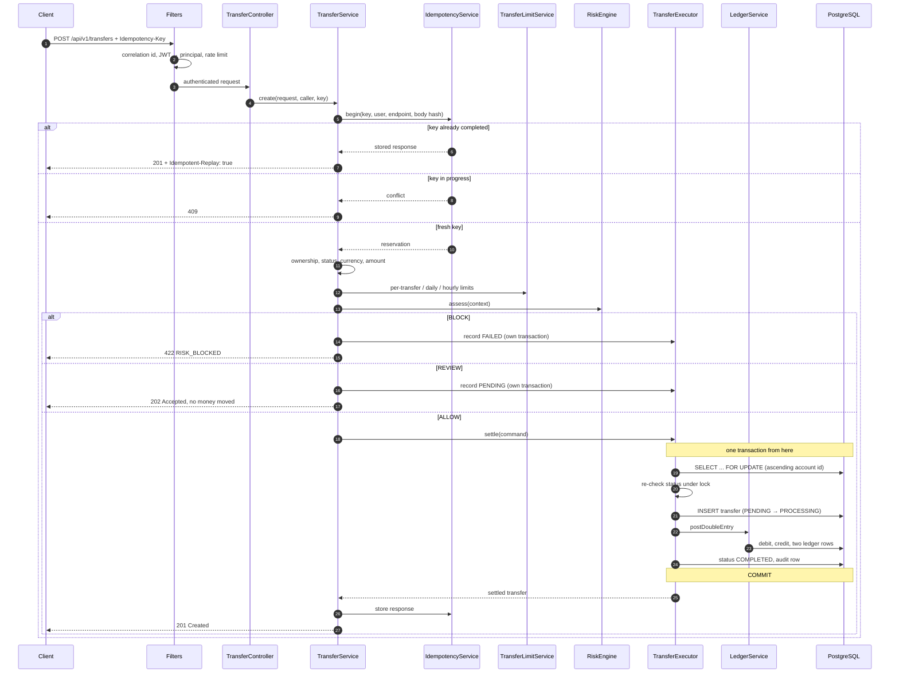
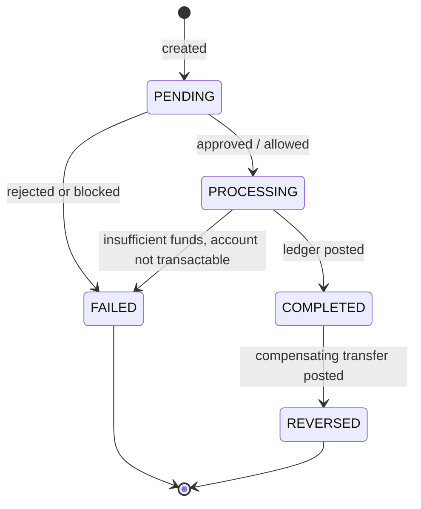

# Architecture

How MBank is put together, and why it is put together that way. Where a decision had a
plausible alternative, the alternative and the reason for rejecting it are stated — a design
document that only lists what was chosen is a description, not an explanation.

---

## 1. Shape of the system

MBank is a **modular monolith**: one deployable unit, divided into feature modules with
explicit boundaries.



### Why a monolith rather than microservices

A transfer must move money out of one account and into another atomically. In a single database
that is one transaction. Split across services it becomes a distributed transaction, and the honest
solutions — sagas with compensating actions, or two-phase commit — are substantially harder to get
right than the problem they replace.

Microservices buy independent deployment and independent scaling. MBank has one team, one
deployment and no component whose load profile differs from the rest. Paying the distributed-systems
cost for benefits nobody can currently collect would be a poor trade.

The module boundaries are real, though: each feature owns its entities, repositories and services,
and modules interact through service interfaces rather than by reaching into each other's tables.
If one module ever genuinely needs to be extracted, the seam is already there.

### Modules

| Module | Responsibility |
|---|---|
| `auth` | Registration, login, JWT issuing, refresh-token rotation, lockout |
| `user` | Profiles, password changes, administrative status changes |
| `account` | Bank accounts, balances, ownership checks, freeze/unfreeze |
| `transfer` | The transfer lifecycle: validation, settlement, queries, administration |
| `ledger` | Double-entry postings — the only code that moves a balance |
| `beneficiary` | Saved payees |
| `card` | Card issuing, freezing, limits, and the encryption of card numbers |
| `verification` | One-time codes and email tokens for both channels |
| `notification` | `SmsService` and `EmailService`, with real and development implementations |
| `risk` | Rules-based risk scoring |
| `limit` | Per-transfer, daily and hourly limits, with per-customer overrides |
| `idempotency` | Reservation and replay of idempotent operations |
| `audit` | Append-only audit trail |
| `admin` | Back-office endpoints (thin; delegates to the modules above) |
| `common` | Errors, money, security, persistence base classes, rate limiting, web plumbing |
| `infrastructure` | Metrics, demo seeding, startup checks |

### Layering

```
controller  →  application service  →  domain  →  repository  →  PostgreSQL
```

Controllers parse, delegate and map to DTOs. They contain no branching on business state. The rule
is enforceable by inspection: no controller in this codebase touches a repository or an entity
setter.

---

## 2. Money

Money is `BigDecimal`, stored as `NUMERIC(19,4)`. Never `double`, never `float`.

`0.1` has no exact binary representation. Add it ten times as a `double` and the result is
`0.9999999999999999`. In a ledger that difference does not stay invisible: it accumulates, and
eventually two sides of an account stop agreeing. `MoneyTest` pins this down with a loop that must
land exactly on `1.00`.

Four decimal places rather than two, so that a future fee or interest calculation has room below the
minor unit without immediately rounding. Client-supplied amounts are checked against the currency's
scale and **rejected** if too precise — silently rounding somebody's money is a defect, not a
convenience.

There is no FX. Transfers between accounts of different currencies are refused with
`CURRENCY_MISMATCH`. Conversion needs rate sourcing, a spread policy and rounding rules; inventing
those would misrepresent balances. Marking it out of scope is more honest than faking it.

---

## 3. The ledger

The authoritative record of money is `ledger_entries`, an append-only double-entry table. Every
movement writes exactly two rows: a `DEBIT` on the source and a `CREDIT` on the destination, equal
in amount.

`bank_accounts.balance` is a **cache** of that position. It exists because reading a balance should
be one indexed row read, not an aggregate over an account's entire history. It is only ever mutated
inside the same transaction that writes the corresponding entries, by a single class
(`LedgerService`), and no other code calls `debit()` or `credit()`.

That invariant is testable, and it is tested:

```java
ledgerService.computeBalanceFromLedger(accountId)  // SUM(credits) − SUM(debits)
    == account.getBalance()                        // the cached column
```

`TransferIT` asserts it for every account after a transfer, and `TransferConcurrencyIT` asserts it
again after a deliberately contentious run.

### Where the money comes from

Money is never created by writing a number into a balance. Each currency has a **system account**
(`MB-SYSTEM-EUR` and so on), seeded by migration `V10`, which is the counterparty for deposits and
withdrawals. Funding a customer account debits the system account by the same amount.

This is why the ledger balances from the very first row, and why a negative system balance is
allowed and meaningful: it is the bank's liability to its customers. A database check constraint
enforces the distinction — `CUSTOMER` accounts may never go negative, `SYSTEM` accounts may.

Without this, opening balances would be ledger-less magic numbers and the reconciliation invariant
would be broken before the first transfer.

---

## 4. The transfer flow



### Why the orchestration is not one transaction

`TransferService` is deliberately **not** `@Transactional`. It coordinates several units of work
that must commit independently:

- the **idempotency reservation** has to survive the business transaction failing, or a failed
  transfer would leave a dangling `IN_PROGRESS` row that blocks the client's own retry;
- a **refusal record** has to survive the rollback that produced it, or an insufficient-funds
  rejection would leave no trace at all;
- the **settlement itself** must be atomic, and is.

Wrapping all of it in one transaction would collapse these into a single all-or-nothing unit, which
is precisely the wrong behaviour. The atomic part lives in `TransferExecutor`; the orchestration
around it does not.

### Order of checks

Identity → ownership → domain validity → limits → risk → settlement. Each stage is cheaper than the
next and produces a more specific error. A customer paying into a frozen account is told
`ACCOUNT_FROZEN`, not given a vague risk refusal.

---

## 5. Concurrency

Two simultaneous transfers from the same account must not both spend the same balance.

**Mechanism: pessimistic row locking with a deterministic lock order.**

`TransferExecutor` takes `SELECT ... FOR UPDATE` on both accounts before reading either balance. The
second transaction blocks at that point and, when it resumes, reads the balance the first one
committed. There is no window in which both see the old value.

Locking two rows introduces a second hazard. If `A→B` locks A then B while `B→A` locks B then A, the
two deadlock. `lockInDeterministicOrder` removes the cycle by always locking in ascending account-id
order regardless of direction: with a total order over the resources, a cycle cannot form.

### Why pessimistic rather than optimistic

Contention on a single account is real — a salary run, a retry storm, a merchant taking payments.
Optimistic locking answers contention with version conflicts surfaced to the user, and a retry storm
makes that worse. Blocking for a few milliseconds is cheaper than failing a payment.

`@Version` is still present on `BankAccount` as a second line of defence for paths that update an
account without going through settlement.

### Defence in depth

A database `CHECK` constraint refuses a negative balance on any customer account. If a bug ever
bypassed the service layer, the transaction would fail rather than commit an overdrawn account.

### Proof

`TransferConcurrencyIT` runs real threads released simultaneously by a latch:

| Scenario | Assertion | Result |
|---|---|---|
| 100 EUR, two concurrent transfers of 80 | exactly one settles, the other gets `INSUFFICIENT_FUNDS`; balance is 20 | passes |
| 100 EUR, twenty concurrent transfers of 10 | exactly ten settle; balance is 0 | passes |
| Five `A→B` and five `B→A`, all at once | all ten settle, no deadlock, balances unchanged | passes |
| Twelve mixed concurrent transfers | cached balance still equals the ledger sum; no money created or destroyed | passes |

---

## 6. Idempotency

A client that times out cannot tell "the request never arrived" from "the response never came back".
Without idempotency the safe action after a timeout is to do nothing, which loses payments. With it,
retrying is always safe.

`POST /api/v1/transfers` requires an `Idempotency-Key` header. The contract:

| Situation | Behaviour |
|---|---|
| First use of the key | Reserved, executed, outcome stored |
| Replay, same body, after success | Stored response returned; **no second payment**. `Idempotent-Replay: true` |
| Replay, same body, after a business failure | The same error is returned — the answer does not change because the client asked twice |
| Replay, **different** body | `422 IDEMPOTENCY_KEY_CONFLICT` — returning the first result would answer a question the client did not ask |
| Replay while the first is still running | `409` — the outcome is not known yet, and guessing could duplicate a payment |
| Infrastructure failure | Reservation released, so a retry is genuinely possible |

Keys are scoped by `(user, endpoint, key)`, so two customers who happen to pick the same key never
collide. A SHA-256 hash of the request body is stored and compared, which is what makes reuse with a
different payload detectable.

The unique constraint on that triple is also the concurrency control: two simultaneous requests with
the same key race to insert, exactly one wins, and the loser sees `IN_PROGRESS`.

---

## 7. Transfer state machine



`PENDING` is not decorative — it is where a transfer sits when the risk engine asked for manual
review. No money has moved; an administrator approves or rejects it.

Transitions go through `Transfer.transitionTo`, which rejects illegal moves. Assigning the status
field directly is how a settled transfer ends up back in `PENDING`, or a failed one is quietly
marked complete. `TransferStatusTest` pins every legal and illegal edge.

### Reversal

A reversal never edits or deletes the original. It writes a **second, opposite transfer** linked to
the first, with its own ledger entries, and marks the original `REVERSED`. Both movements stay in
the account history and the ledger still balances. That is how a real ledger records a correction:
the mistake and its remedy are both visible.

---

## 8. Risk engine

A rules-based scorer. It is **not** presented as bank-grade fraud detection — real systems combine
device fingerprinting, behavioural models and shared industry intelligence. What it demonstrates is
the shape: independent rules, an accumulated score, configurable thresholds, and a decision recorded
against the transfer so any hold can be explained afterwards.

| Rule | Signal | Default score |
|---|---|---|
| `LARGE_AMOUNT` | Amount at or above an absolute threshold | 35 |
| `HIGH_VELOCITY` | Several transfers within a short window | 30 |
| `UNUSUAL_AMOUNT` | Far above this customer's own recent average | 25 |
| `RECENT_FAILED_LOGINS` | Failed authentications shortly before the transfer | 20 |
| `NEW_BENEFICIARY_LARGE_TRANSFER` | Large payment to a payee added moments ago | 30 |
| `BALANCE_SWEEP` | Moves ≥ 90% of the available balance | 25 |

Score ≥ 50 → `REVIEW`. Score ≥ 85 → `BLOCK`. Both thresholds are configuration.

Rules are Spring beans implementing `RiskRule`, collected by injection: adding one is a new class,
with no registry to update. A rule that throws is caught and logged, and the others still run — a
bug in a heuristic must not take down payments.

A frozen or closed destination is deliberately **not** a risk rule. It is not a matter of degree, so
it is a hard validation returning a precise `ACCOUNT_FROZEN`.

---

## 9. Authentication

Short-lived JWT access tokens (15 minutes) plus long-lived, rotating refresh tokens (7 days).

- Access tokens are stateless and carry the user id and role, so authorization needs no database
  read on the hot path.
- Refresh tokens are stored as **SHA-256 hashes**. A dump of that table yields nothing usable.
  SHA-256 rather than BCrypt because the token is 256 bits of cryptographic randomness — there is no
  low-entropy secret to slow-hash, and lookup must be a single indexed read.
- Every refresh **rotates**: the presented token is burned and a new one issued in the same family.
- If an already-rotated token is presented again, that means two parties hold it. The safe
  assumption is theft, so the **entire family is revoked** and both are logged out.

The revocation is committed in its own transaction (`TokenFamilyRevoker`). This is not incidental:
reuse detection ends by throwing, and a revocation inside that transaction would be rolled back by
the very exception that reports the detection — the check would appear to work while doing nothing.
That exact bug existed during development and was caught by an integration test.

The same reasoning drives `LoginAttemptService`: a failed login must persist its incremented counter
while still ending in an exception, so it commits separately.

`VerificationAttemptService` exists for the identical reason and was written after the identical
bug: a wrong one-time code has to increment an attempt counter *and* end by throwing. Counting it
inside the doomed transaction meant the rollback took the increment with it, so the five-attempt
limit never fired and a six-digit code could be guessed without bound. An integration test caught
it; the fix is a separate bean committing `REQUIRES_NEW`.

### Phone and email verification

One entity, `VerificationCode`, serves both channels. They differ only in the shape of the secret —
six digits a person retypes, versus a long random token they click — while everything that matters
is identical: expiry, attempt counting, resend cooldown, single use. Two near-identical entities
would mean fixing every future bug twice.

Five rules hold for both:

1. a code lives for a fixed, short time;
2. a limited number of wrong guesses burns it;
3. a resend cannot be requested faster than the cooldown;
4. a successful check consumes it immediately, so it works exactly once;
5. **only one code is ever live per destination and purpose.**

The fifth is the one a naive implementation gets wrong. Appending a row per request leaves every
previously sent code valid, so the attacker's target grows with each resend instead of resetting. A
unique constraint on `(channel, destination, purpose)` makes that structurally impossible: a resend
updates the row.

The secret itself is never stored. What is stored is a keyed HMAC — not BCrypt, which would be the
right answer for a password but is wrong here (a code is protected by living five minutes and
allowing five guesses, not by being slow to verify), and not a bare digest, which for six digits is
a rainbow table anybody could build in a second.

### Registering a phone number

A verified number is a sign-in credential, so it is proven *before* the account exists. The proof
travels as a short-lived, single-use ticket issued when the code checks out and redeemed at
registration. Without it the server would have to infer "this number was verified" from a row it
cannot attribute to the caller — and anyone who knew a number had just been confirmed could register
against it.

---

## 9a. Cards

Cards are the one place in this codebase holding data that is valuable on its own, so the module is
arranged around not holding it.

**The number** is stored only as AES-256-GCM ciphertext. GCM rather than CBC because it
authenticates as well as encrypts: a tampered ciphertext fails to decrypt instead of yielding a
different valid-looking number. A fresh IV per card means two identical numbers do not encrypt
identically. `bin` and `last_four` are stored in the clear so that every ordinary read path — lists,
dashboards, statements — decrypts nothing at all.

**Uniqueness** is enforced on a keyed HMAC of the number, so "has this been issued before" is an
indexed equality check that never has the plaintext to compare against.

**The verification value is not stored anywhere, in any form.** There is no column for it. It is
derived on demand by HMAC over the card id, number and expiry under a server-side key — which is
what an issuer does with a card verification key, and which means a database dump contains nothing
to steal. This is the single most important decision in the module and the reason `cards` has the
shape it does.

Three keys, one root secret, separated by domain labels, so a compromise of one purpose cannot be
replayed against another. The root is the configured `CARD_ENCRYPTION_KEY`, or the JWT secret when
that is unset — which keeps a fresh checkout working without a second secret to configure, while
allowing the two to be rotated independently in a real deployment.

**Access** goes through one method, `CardService.requireOwnCard`, for the same reason account access
does. Administrators are deliberately *not* granted a bypass here: reading another customer's card
is not part of any workflow this application implements, and the blanket admin exemption that
account lookups carry would quietly extend to card numbers.

Revealing full details is a `POST`, individually audited and rate-limited to a handful of calls an
hour. A `GET` would be cacheable, linkable and replayable from browser history.

---

## 10. Observability

| Concern | Implementation |
|---|---|
| Health | `/actuator/health` with liveness and readiness probes; the Docker healthcheck uses readiness |
| Metrics | Micrometer with a Prometheus endpoint |
| Business metrics | `minibank.transfers{status,currency}`, `minibank.transfers.amount`, `minibank.risk.decisions{decision}`, `minibank.idempotency.replays`, `minibank.login.failures` |
| Correlation | `X-Request-Id` accepted (validated) or generated, put in the MDC, echoed in the response, stored on every audit row |
| Structured logs | JSON via `logstash-logback-encoder` under the `docker`, `demo` and `prod` profiles |

Heap usage and request latency come free from Actuator. What an operator actually needs during an
incident is whether transfers are still settling and whether the risk engine has started blocking
everything, so those are counted explicitly.

A client-supplied correlation id is **validated** against `^[A-Za-z0-9_.:-]{1,64}$` before it
reaches the MDC. It ends up in log lines, and accepting arbitrary text would allow log forging
through embedded newlines.

Passwords, access tokens and refresh tokens are never logged. The credential-bearing DTOs override
`toString()` so they cannot leak through a stack trace either.

---

## 11. Performance

- `spring.jpa.open-in-view` is **off**. An open session in the view layer hides lazy loading behind
  rendering, which is how N+1 queries reach production unnoticed.
- Transfer listings use `@EntityGraph` to fetch both accounts in one query. Without it, a page of
  twenty rows would fire forty extra queries to render account numbers.
- Filtering uses Spring Data **Specifications** rather than JPQL full of `:param IS NULL OR …`.
  Besides being unreadable, that pattern emits untyped null parameters PostgreSQL cannot infer types
  for, and forces the planner to consider predicates the caller never asked for.
- Pagination is always done in the database, and page size is clamped to 100.
- Sort properties are whitelisted. Spring Data will otherwise sort by any entity property a client
  names, including ones that are not part of the public contract.
- Indexes cover every documented access path — see [database.md](database.md).

---

## 12. Testing strategy

269 tests: 128 unit, 141 integration.

Integration tests run against **real PostgreSQL** via Testcontainers, not H2. The behaviour under
test *is* PostgreSQL behaviour — `SELECT … FOR UPDATE`, `NUMERIC(19,4)` arithmetic, partial unique
indexes, JSONB, check constraints. An in-memory substitute would either not support these or emulate
them differently, so a green suite would prove nothing about production.

Tests are **not** wrapped in a rolled-back transaction. Much of what matters depends on real commit
boundaries: `REQUIRES_NEW` audit rows, idempotency reservations, and row locks taken by concurrent
threads. Each test truncates and reseeds instead.

Risk and limit thresholds are pushed out of reach in the shared test profile, and the tests that
exercise them set their own values. Otherwise a concurrency test would silently also be a risk-engine
test, and its failures would be ambiguous.

---

## 13. Deliberate limitations

Stated plainly, because a portfolio project that pretends to be production-complete is less
convincing than one that knows where its edges are.

| Limitation | What production would need |
|---|---|
| Rate limiting is in-process | Behind a load balancer each node enforces its own budget. A shared counter (Redis `INCR` with expiry, or a Lua token bucket) would fix it; only `TokenBucketRateLimiter` changes |
| Tokens in `localStorage` | Refresh token in an httpOnly, SameSite cookie plus CSRF protection on the refresh endpoint |
| No FX | Rate sourcing, spread policy, rounding rules, and a quote lifecycle |
| Risk engine is heuristic | Behavioural models, device fingerprinting, shared intelligence |
| Single database, no read replicas | Read replicas for reporting; the write path must stay on the primary |
| No outbox / event publishing | An outbox table if asynchronous consumers are ever added, so publication cannot diverge from the transaction that caused it |
| Access tokens cannot be revoked individually | Accepted by design: revocation is handled by the stateful refresh chain, keeping the hot path free of database reads. A denylist would be needed for instant revocation |
