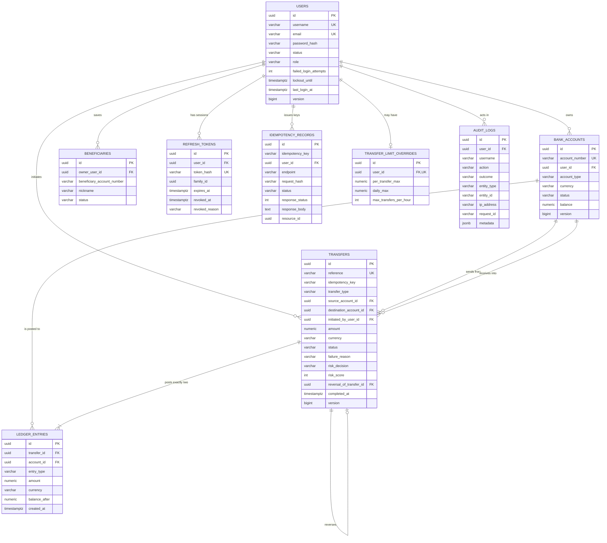

# Database design

PostgreSQL 16. Schema managed exclusively by Flyway; Hibernate runs with
`ddl-auto: validate`, so a drift between the entities and the migrations is a startup failure rather
than a silent inconsistency.

---

## Entity relationships



---

## Migrations

| Version | What it does |
|---|---|
| `V1__create_users.sql` | Users, with status/role checks and the lockout columns |
| `V2__create_bank_accounts.sql` | Accounts, with the non-negative-balance and ownership constraints |
| `V3__create_transfers.sql` | Transfers, with the status, amount and settlement-time constraints |
| `V4__create_ledger_entries.sql` | Append-only double-entry ledger |
| `V5__create_beneficiaries.sql` | Saved payees, with the partial unique index |
| `V6__create_audit_logs.sql` | Append-only audit trail with JSONB metadata |
| `V7__create_refresh_tokens.sql` | Hashed refresh tokens and rotation families |
| `V8__create_idempotency_records.sql` | Idempotency reservations and stored responses |
| `V9__create_transfer_limit_overrides.sql` | Per-customer limit overrides |
| `V10__create_system_accounts.sql` | One funding account per currency |
| `V12__create_cards.sql` | Payment cards. No CVV column exists, by design |
| `V11__add_transfer_risk_reasons.sql` | Why the risk engine reached its verdict, as JSONB |
| `V12__create_cards.sql` | Payment cards. No CVV column exists, by design |
| `V13__create_verification.sql` | One-time codes, plus E.164 normalisation and a unique index on `users.phone_number` |
| `V14__add_transaction_categories.sql` | A nullable `category` on transfers. Never inferred retroactively |
| `V15__add_card_controls.sql` | Five channel switches and two more caps per card |
| `V16__create_savings_goals.sql` | Goals over dedicated accounts, plus `bank_accounts.purpose` |
| `V17__create_budgets.sql` | Monthly caps per category. Spend is derived, never stored |
| `V18__create_notifications.sql` | The in-app feed, with a partial index for the unread badge |
| `V19__create_scheduled_transfers.sql` | Standing orders, with a partial index on the due ones |
| `V20__create_money_requests.sql` | Payment requests, with a constraint tying PAID to its transfer |
| `V21__create_support_tickets.sql` | Tickets and their append-only message thread |
| `V22__add_session_metadata.sql` | Device, IP and last-used on refresh tokens; favourite payees |
| `V23__add_password_reset_purpose.sql` | A fourth verification purpose, so a reset code cannot sign anyone in |

Applied migrations are never edited. A change to a shipped migration would leave existing databases
inconsistent with new ones while Flyway's checksum validation reported everything as fine — the
correction goes in a new version.

---

## Why UUID primary keys

Account and transfer ids appear in URLs. A sequential key would let one customer probe another's
resources by decrementing a number; discovering that `/api/v1/accounts/{id}` returns `404` for an id
that does exist is still an information leak about how many accounts the bank has. Random UUIDs
remove the oracle entirely.

The same reasoning drives account numbers (`MB-` plus twelve `SecureRandom` digits) and transfer
references (`TRX-YYYY-XXXXXXXX`). Account numbers in particular are shared with third parties in
order to receive money — they are identifiers, and must not double as an enumeration tool. The
reference alphabet omits `I`, `O`, `0` and `1`, which are indistinguishable when read aloud.

---

## Constraints that enforce financial invariants

The application enforces these too. They are also in the database because a bug in the service layer
should not be able to commit a broken state — the last line of defence must not be code that could
contain the bug.

| Constraint | Guarantees |
|---|---|
| `ck_bank_accounts_balance_non_negative` | A `CUSTOMER` account can never hold a negative balance. `SYSTEM` accounts may, because a negative system balance is the bank's liability to its customers |
| `ck_bank_accounts_owner` | A customer account has an owner; a system account does not |
| `ck_transfers_distinct_accounts` | Source and destination always differ |
| `ck_transfers_amount_positive` | No zero or negative transfer can be stored |
| `ck_transfers_completed_at` | A `COMPLETED` or `REVERSED` transfer has a settlement time; anything else does not pretend to |
| `uq_ledger_entries_transfer_leg` | One posting per side per transfer — a retry can never double-post a leg |
| `ck_ledger_entries_amount_positive` | Direction is carried by `entry_type`, never by a negative amount |
| `uq_idempotency_scope` | One reservation per `(user, endpoint, key)`; this is also the concurrency control for simultaneous replays |
| `uq_transfers_reference`, `uq_bank_accounts_number` | Uniqueness of customer-facing identifiers is owned by the database, not by a generator's retry loop |

### The partial unique index

```sql
CREATE UNIQUE INDEX uq_beneficiaries_owner_account_active
    ON beneficiaries (owner_user_id, beneficiary_account_number)
    WHERE status = 'ACTIVE';
```

Beneficiaries are soft-deleted so the relationship history stays available to the risk engine. A
plain unique constraint would then block re-adding a payee that was removed. Scoping the index to
active rows allows re-adding while still preventing duplicate live entries.

---

## Indexes

Every index below exists for a specific query the application actually issues.

| Index | Serves |
|---|---|
| `uq_users_username`, `uq_users_email` | Login and duplicate-registration checks |
| `idx_bank_accounts_user` | Listing a customer's accounts |
| `uq_bank_accounts_number` | Resolving a destination account number on every transfer |
| `idx_transfers_source_created`, `idx_transfers_destination_created` | Per-account statements, newest first |
| `idx_transfers_initiator_created` | Velocity and daily-total queries in the risk and limit checks |
| `idx_transfers_status` | Administrative search by status; finding transfers awaiting review |
| `uq_transfers_reference` | Customer support looking up a quoted reference |
| `idx_ledger_entries_account_created` | Ledger reconciliation and account history |
| `idx_ledger_entries_transfer` | Fetching the two entries backing one transfer |
| `idx_audit_logs_user_created`, `idx_audit_logs_action_created` | Audit search by user or action |
| `uq_idempotency_scope` | The reservation lookup on every idempotent request |
| `idx_refresh_tokens_family` | Family-wide revocation on reuse detection |
| `idx_refresh_tokens_expires_at` | The nightly purge of expired tokens |

The composite indexes lead with the equality column and end with `created_at DESC`, matching both
the filter and the sort, so the common "this account's history, newest first" query is served
without a sort step.

---

## Append-only tables

`ledger_entries` and `audit_logs` are mapped `@Immutable`, so Hibernate will not issue an `UPDATE`
for them. Append-only is enforced by the mapping rather than by convention, and no application code
path deletes from either.

Corrections to the ledger are made with compensating entries. Financial history is never physically
deleted — closing an account changes its status, it does not remove its transactions.

---

## Derived rather than stored

Four figures a customer sees are computed at read time from rows that already exist, rather than
being kept in a column and maintained:

| Figure | Derived from | Why not stored |
|---|---|---|
| Savings goal progress | The backing account's balance | A stored total drifts from the ledger after a reversal or a concurrent write, and a savings screen that disagrees with the ledger is worse than none |
| Budget spend | The month's transfers in that category | A recategorised payment is reflected immediately, with no backfill |
| Statement opening balance | `balance_after` of the entry before the period | No month-end snapshot to write, and nothing to rebuild if a job misses a month |
| Card and money-request expiry | The clock, against a stored date | A job that fails to run would leave expired things looking usable — the wrong direction to fail in |

The cost is a little arithmetic per request. The benefit is that these numbers cannot be wrong.

---

## Retention

| Data | Policy |
|---|---|
| Expired refresh tokens | Purged nightly, seven days after expiry |
| Idempotency records | Purged nightly after seven days — long enough that no client is still retrying |
| Ledger entries, transfers, audit logs | Never deleted |
| Users, accounts, beneficiaries | Soft-deleted (status change) so financial history stays attributable |
